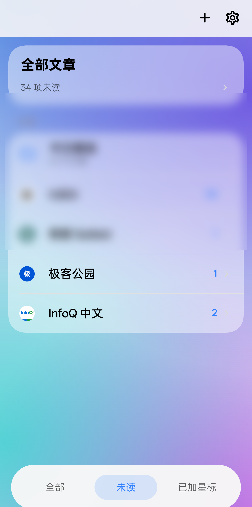
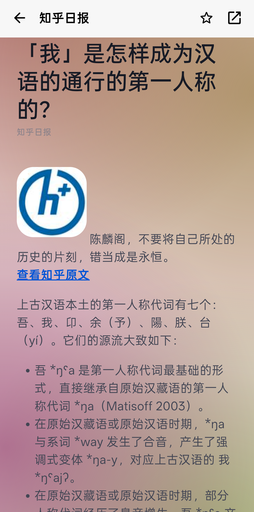
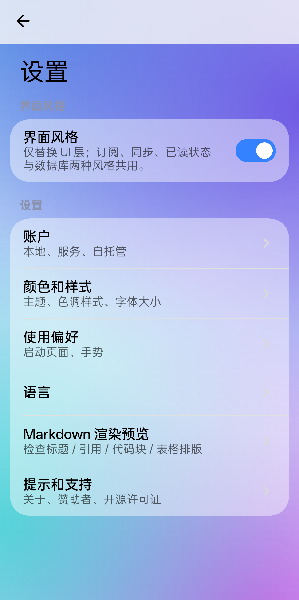

# Read You · Miuix / HyperOS 皮肤

在 [Read You](https://github.com/ReadYouApp/ReadYou) 0.16.2 的基础上，额外提供一套 **MIUI / HyperOS 风格** 的界面，业务层（解析、同步、数据库、阅读进度）完全不变。

界面风格可在 **设置 → 界面风格** 中一键切换，Material 原版界面与 Miuix 皮肤共用同一套数据。

> 本项目是 Read You 的衍生作品，遵循 **GPL-3.0**。上游版权归 Read You 作者所有。

## 截图

| 订阅主页 | 阅读页 |
| --- | --- |
|  |  |

| Markdown 渲染 | 设置 |
| --- | --- |
|  |  |

> 截图中的订阅名已模糊处理，并移除了状态栏、通知与包含第三方信息的区域。

## 新特性

### 1. Miuix / HyperOS 视觉

- 基于 [Miuix](https://github.com/miuix-kotlin-multiplatform/miuix)（HyperOS 设计语言的 Compose 实现）构建的组件：卡片、胶囊底栏、开关、列表项。
- **整屏莫奈取色**：主页用壁纸主色，进入订阅时取该订阅图标的主色，进入文章时取封面主色；颜色在绘制阶段做 700ms 插值过渡，滚动时不产生额外重组。
- **玻璃质感背景**：单一对角线性渐变 + 预先混合的不透明卡片，兼顾观感与帧率。
- 底部胶囊分段栏承载「全部 / 未读 / 已加星标」，符合 HyperOS 的导航习惯。

### 2. 阅读体验

- **Ushio 风格 HTML 渲染层**：不把 HTML 转成 Markdown，而是在 Jsoup DOM → Compose 的映射层直接产出卡片式排版
  - 正文 16sp / 行高 1.7× / 段距 14dp
  - 标题左侧强调条 + 细分隔线，段前 24dp / 段后 10dp
  - 引用块：10dp 圆角卡片 + 4dp 圆头强调色竖条
  - 代码块：12dp 圆角卡片 + 语言标签 + 一键复制 + 轻量语法高亮 + 横向滚动
  - 表格：圆角卡片 + 表头底色 + 细网格线 + 横向滚动
  - 图片：12dp 圆角 + 细描边，`<figcaption>` 渲染为居中浅色图注；头像/图标按真实解码尺寸识别，不再被拉伸成整屏大图
  - 清洗：懒加载图片（`data-src` 等）提升为 `src` 并补全绝对路径，剔除内联 `style` 与空占位节点
- **Markdown 阅读器**：以 [multiplatform-markdown-renderer](https://github.com/mikepenz/multiplatform-markdown-renderer) 为底座，自定义 typography / padding / components，与 HTML 阅读层保持同一套观感
- **文内目录**：自动提取 h1–h4，右下角悬浮按钮唤起胶囊目录，点击平滑跳转
- **快速滚动条 + 回到顶部**：右侧细滚动条拖动定位，下滑后右下角出现回顶按钮
- **全局下滑隐藏顶栏**：主页、列表、阅读页、内嵌浏览器一致
- **内嵌浏览器**：可切换「用外部浏览器打开」，非 http(s) 协议（如 `zhihu://`）交还系统处理

### 3. 工程

- 构建缓存 + 配置缓存：单文件改动后的增量构建从 ~4.5 分钟降到 ~30 秒
- 取色结果落盘缓存、HTML 解析结果内存 LRU，冷启动与重复进入文章更快
- 未改动业务代码：同步、解析、Room 数据库、Paging 逻辑与上游一致

## 构建

```bash
# 调试版（包名 me.ash.reader.miuix，可与官方版共存）
./gradlew :app:assembleGithubDebug

# 发布版（需要在 signature/keystore_release.properties 配置签名）
./gradlew :app:assembleGithubRelease
```

`signature/keystore_release.properties` 示例（该目录已被 git 忽略）：

```properties
storeFile=../signature/release.jks
storePassword=******
keyAlias=readyou
keyPassword=******
```

环境要求：JDK 17+、Android SDK Platform 37（Miuix 的 AAR 依赖 API 37）。

## 与上游的差异

改动集中在 UI 层：

- `ui/miuix/`：Miuix 皮肤全部页面与组件（新增）
- `ui/page/nav3/AppEntry.kt`：按偏好开关分发到 Miuix 或 Material 页面
- `ui/component/reader/`、`ui/component/webview/`：仅新增可选参数，默认行为不变
- `infrastructure/preference/`：新增 `uiStyle` 偏好

## 已知限制

- 部分源的正文里没有 `<a>` 标签（例如知乎日报的「查看知乎原文」），此时无法渲染成链接
- HTML → Ushio 样式的转换覆盖常见块级元素，复杂富文本（嵌套表格、内联 SVG、视频）会被简化
- 取色依赖图片可访问，离线或防盗链时回退为壁纸主色

## 致谢

- [Read You](https://github.com/ReadYouApp/ReadYou) — 基础应用（GPL-3.0）
- [Miuix](https://github.com/miuix-kotlin-multiplatform/miuix) — HyperOS 风格组件（Apache-2.0）
- [multiplatform-markdown-renderer](https://github.com/mikepenz/multiplatform-markdown-renderer) — Markdown 渲染底座（Apache-2.0）
- [Halcyon](https://github.com/jiankangw59-blip/Halcyon) — 视觉参考
